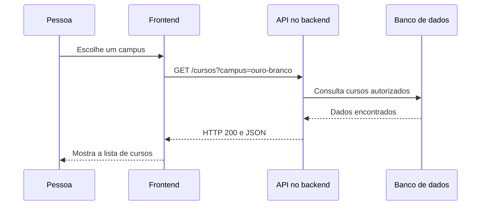

# O que é uma API e como ela funciona

**API** é a sigla de *Application Programming Interface* (interface de programação de aplicações). É um **contrato de interação**: define quais operações um programa oferece, como outro programa pode solicitá-las e quais resultados ou erros deve esperar.

A ideia é familiar para quem trabalha com design. Em um componente do Figma, quem utiliza uma instância precisa conhecer as propriedades e as ações disponíveis, mas não precisa conhecer toda a estrutura interna que produz cada resultado. Uma API faz algo semelhante para o código: expõe recursos e esconde detalhes de implementação.

**O ponto mais importante:** API não é sinônimo de servidor, de banco de dados nem de internet. O navegador oferece APIs como `document.querySelector()`; uma biblioteca pode expor uma API de funções; e um serviço remoto pode oferecer uma **API web**, acessada pela rede. Este artigo concentra-se nessa última, que aparece no frontend e no backend. A comparação de implementações em diferentes linguagens está mais adiante.

## O que acontece quando dois sistemas conversam

Imagine um catálogo de cursos: a pessoa escolhe um campus no site, e a interface precisa mostrar os cursos correspondentes.

1. O **frontend** identifica a ação e monta uma requisição.
2. A requisição chega a um **endereço da API** no servidor.
3. O **backend** verifica o pedido, aplica as regras necessárias e, se for o caso, consulta o banco de dados.
4. O servidor envia uma **resposta** com um código de situação e, normalmente, dados.
5. O frontend interpreta a resposta e atualiza a interface.



Esse é um exemplo possível, não uma arquitetura obrigatória. A API pode executar uma operação sem banco de dados, consultar outro serviço ou devolver uma resposta que não contém dados.

## Quais são as peças de uma requisição

Em APIs web, a comunicação costuma usar **HTTP** (*Hypertext Transfer Protocol*, protocolo de transferência de hipertexto), ou **HTTPS** (*Hypertext Transfer Protocol Secure*, HTTP protegido por criptografia de transporte). Uma requisição tem partes com responsabilidades diferentes.

* **URL** (*Uniform Resource Locator*, localizador uniforme de recursos): o endereço do recurso ou operação, como `https://api.github.com/repos/leorruas/programacao`.
* **Endpoint**: o ponto de acesso definido pela API, normalmente uma combinação de caminho e método HTTP.
* **Método HTTP**: a intenção da chamada, como consultar ou criar um recurso.
* **Parâmetros de caminho e de consulta**: valores que identificam ou filtram informações, como `/cursos/42` ou `/cursos?campus=ouro-branco`.
* **Cabeçalhos (headers)**: metadados do pedido, como o tipo de resposta aceito e credenciais, quando necessárias.
* **Corpo (body)**: dados enviados pelo cliente, usados frequentemente em operações de criação e atualização.

Por exemplo, este pedido solicita informações públicas de um repositório do GitHub:

```http
GET /repos/leorruas/programacao HTTP/1.1
Host: api.github.com
Accept: application/vnd.github+json
```

O método é `GET`. O endereço e o formato de resposta esperado compõem parte do contrato. Não há corpo nesse exemplo.

## O que volta na resposta

O servidor responde com um **código de status HTTP**, cabeçalhos e, quando aplicável, um corpo. Uma resposta de sucesso poderia ser representada assim:

```http
HTTP/1.1 200 OK
Content-Type: application/json

{
  "full_name": "leorruas/programacao",
  "private": false
}
```

**JSON** (*JavaScript Object Notation*, notação de objetos JavaScript) é um formato textual estruturado. Ele é comum em APIs, mas não obrigatório: uma API pode devolver texto, arquivos, imagens ou uma resposta sem corpo. A estrutura acima ilustra apenas parte dos campos que o GitHub pode devolver.

Status frequentes:

| Código | Significado no contexto |
| :--- | :--- |
| `200 OK` | Pedido atendido com sucesso. |
| `201 Created` | Recurso criado. |
| `204 No Content` | Pedido atendido sem corpo na resposta. |
| `400 Bad Request` | Pedido inválido para as regras do servidor. |
| `401 Unauthorized` | Falta autenticação válida. |
| `403 Forbidden` | O cliente não tem permissão para a operação. |
| `404 Not Found` | O recurso não foi encontrado ou não é exposto naquele endereço. |
| `429 Too Many Requests` | Limite de requisições excedido. |
| `500 Internal Server Error` | Falha interna do servidor. |
| `502 Bad Gateway` | Um intermediário recebeu resposta inválida de outro servidor. |
| `503 Service Unavailable` | Serviço temporariamente indisponível. |

Um `404` significa que houve uma resposta HTTP com erro. Já uma falha de conexão pode impedir que uma resposta HTTP chegue. Essa diferença importa ao tratar erros no código.

## O que significam GET, POST, PUT, PATCH e DELETE

As APIs web frequentemente organizam operações com métodos HTTP. Em uma API de cursos, os endpoints poderiam funcionar assim:

| Método | Exemplo | Intenção mais comum |
| :--- | :--- | :--- |
| `GET` | `/cursos` | Consultar uma lista de cursos. |
| `GET` | `/cursos/42` | Consultar um curso específico. |
| `POST` | `/cursos` | Criar um curso. |
| `PUT` | `/cursos/42` | Substituir a representação de um curso. |
| `PATCH` | `/cursos/42` | Alterar parte de um curso. |
| `DELETE` | `/cursos/42` | Solicitar a exclusão de um curso. |

Esses são exemplos de convenções, não endpoints reais do IFMG. A API determina quais rotas existem, seus formatos e suas permissões.

Às vezes aparece a sigla **CRUD** (*Create, Read, Update, Delete*: criar, ler, atualizar e excluir). Ela descreve operações sobre dados. Os métodos HTTP frequentemente implementam essas ações, mas CRUD e HTTP não são a mesma coisa.

## Onde entram o frontend, o backend e o banco de dados

O **frontend** é a camada que apresenta a interface e reage às ações da pessoa. O **backend** executa regras e operações do lado do servidor. O **banco de dados** armazena informações quando o sistema precisa de persistência.

Uma API pode ser a fronteira pela qual o frontend solicita ações ao backend. Mas o backend também pode **consumir** APIs de terceiros: por exemplo, receber uma solicitação de CEP, consultar um serviço externo e devolver somente os campos úteis para a interface.

Por que passar pelo backend em vez de chamar tudo diretamente do navegador? Às vezes é necessário proteger segredos, validar permissões, combinar dados ou controlar o volume de requisições. Em outros casos, consultar uma API pública diretamente do frontend é uma escolha adequada.

## Como a API define o que pode ser feito

Uma API depende de um **contrato**: documentação de rotas, métodos, parâmetros, autenticação, formato dos dados e possíveis erros. Se você pede um campo que não existe ou usa um método que a rota não aceita, o servidor pode rejeitar a chamada.

Duas distinções ajudam:

* **Autenticação** identifica quem está fazendo o pedido. **Autorização** verifica o que essa identidade pode fazer. Uma chave ou token pode ser exigido, mas nem todas as APIs precisam deles.
* **CORS** (*Cross-Origin Resource Sharing*, compartilhamento de recursos entre origens) é uma política aplicada pelos navegadores para controlar leitura de respostas de outras origens. Uma chamada de servidor para servidor normalmente não está sujeita à mesma verificação de CORS feita pelo navegador.

O contrato também pode limitar frequência de chamadas, quantidade de resultados, versões aceitas e operações disponíveis. Por isso, **uma API pública não significa necessariamente uma API irrestrita**.

## API, REST e outros estilos

**REST** (*Representational State Transfer*, transferência de estado representacional) é um estilo de arquitetura para sistemas distribuídos. Muitas APIs HTTP adotam convenções inspiradas em REST, como recursos identificados por URLs e métodos HTTP com significados conhecidos.

Nem toda API é REST. Existem, por exemplo, APIs **GraphQL**, nas quais o cliente descreve os dados que deseja, e APIs no estilo **RPC** (*Remote Procedure Call*, chamada de procedimento remoto), mais centradas em invocar operações. Saber usar HTTP e entender o contrato vem antes de decorar um estilo.

## A mesma chamada em quatro linguagens

Os exemplos abaixo fazem uma requisição `GET` à API pública do GitHub para consultar um repositório. **O contrato HTTP é o mesmo**, mas cada linguagem oferece ferramentas próprias para acessá-lo. Os exemplos não exigem chave privada.

### JavaScript no navegador ou no Node.js moderno

```javascript
async function consultar() {
    const resposta = await fetch("https://api.github.com/repos/leorruas/programacao");
    if (!resposta.ok) throw new Error(`HTTP ${resposta.status}`);

    const dados = await resposta.json();
    console.log(dados.full_name);
}

consultar().catch(console.error);
```

A função `fetch()` devolve uma `Promise`, que representa a operação assíncrona. Um status 404, por exemplo, normalmente não rejeita essa promessa automaticamente: a verificação de `resposta.ok` é necessária.

### C# com .NET 6 ou superior

```csharp
using System;
using System.Net.Http;
using System.Text.Json;

using var cliente = new HttpClient();
cliente.DefaultRequestHeaders.UserAgent.ParseAdd("CadernoProgramacao/1.0");

using var resposta = await cliente.GetAsync(
    "https://api.github.com/repos/leorruas/programacao"
);
resposta.EnsureSuccessStatusCode();

using var dados = JsonDocument.Parse(await resposta.Content.ReadAsStringAsync());
Console.WriteLine(dados.RootElement.GetProperty("full_name").GetString());
```

`HttpClient` envia a requisição; `EnsureSuccessStatusCode()` gera exceção quando o status HTTP não indica sucesso. Em aplicações de servidor que fazem muitas chamadas, prefira gerenciar clientes reutilizáveis, como explica [[csharp/25-Consumindo APIs em Csharp|Consumindo APIs em C#]].

### Python com a biblioteca padrão

```python
import json
from urllib.request import Request, urlopen
from urllib.error import HTTPError, URLError

pedido = Request(
    "https://api.github.com/repos/leorruas/programacao",
    headers={"User-Agent": "CadernoProgramacao/1.0"}
)

try:
    with urlopen(pedido, timeout=10) as resposta:
        dados = json.load(resposta)
        print(dados["full_name"])
except HTTPError as erro:
    print("Erro HTTP:", erro.code)
except URLError as erro:
    print("Falha de conexão:", erro.reason)
```

`urlopen()` envia a requisição e `json.load()` transforma o conteúdo recebido em dados Python. O tratamento diferencia respostas HTTP de erro e falhas de conexão.

### Java 11 ou superior

```java
import java.net.URI;
import java.net.http.HttpClient;
import java.net.http.HttpRequest;
import java.net.http.HttpResponse;

public class ConsultarApi {
    public static void main(String[] args) throws Exception {
        HttpClient cliente = HttpClient.newHttpClient();
        HttpRequest pedido = HttpRequest.newBuilder()
            .uri(URI.create("https://api.github.com/repos/leorruas/programacao"))
            .header("User-Agent", "CadernoProgramacao/1.0")
            .GET()
            .build();

        HttpResponse<String> resposta =
            cliente.send(pedido, HttpResponse.BodyHandlers.ofString());

        if (resposta.statusCode() < 200 || resposta.statusCode() >= 300) {
            throw new IllegalStateException("HTTP " + resposta.statusCode());
        }
        System.out.println(resposta.body());
    }
}
```

O `HttpClient` do Java envia a chamada e recebe o corpo como texto. Para ler campos específicos do JSON, seria preciso interpretá-lo com uma biblioteca apropriada.

## O que muda e o que permanece

| Etapa | O que as quatro linguagens compartilham |
| :--- | :--- |
| Encontrar o recurso | A mesma URL e o mesmo endpoint |
| Solicitar informações | Método HTTP `GET` |
| Verificar resultado | Código de status HTTP |
| Interpretar resposta | Estrutura de dados documentada, aqui JSON |
| Tratar falhas | Diferenciar status de erro, rede e dados inválidos |

A escolha da linguagem também afeta o **ambiente de execução**. No navegador, políticas como CORS (*Cross-Origin Resource Sharing*, compartilhamento de recursos entre origens) podem limitar a leitura de respostas de outros domínios; clientes executados no servidor geralmente não têm essa restrição.

## Exemplo pequeno: consumindo uma API com JavaScript

A função `fetch()` inicia uma requisição e devolve uma `Promise`, que representa uma operação assíncrona. O código abaixo consulta uma API pública do GitHub:

```javascript
const resposta = await fetch("https://api.github.com/repos/leorruas/programacao");

if (!resposta.ok) {
  throw new Error("HTTP " + resposta.status);
}

const repositorio = await resposta.json();
console.log(repositorio.full_name);
```

Aqui, `resposta.ok` indica um status de sucesso (na faixa 200 a 299). A chamada a `resposta.json()` interpreta o corpo JSON e produz um valor JavaScript. **Um `fetch()` que recebe `404` normalmente não rejeita a Promise por si só**: precisamos verificar o status. Erros de rede podem rejeitar a Promise e ser capturados com `try/catch`.

Para aprofundar essa parte, estude [[javascript/05-assincrono/03-Fetch|Fetch]], [[javascript/05-assincrono/04-Async await|Async e await]] e [[javascript/06-arquitetura-e-avancado/06-Tratamento de erros|Tratamento de erros]].

## Exemplo completo: um botão que consulta dados reais

Salve o código abaixo como `index.html` e abra no navegador. Ao clicar no botão, a página consulta a API pública do GitHub e mostra alguns campos do repositório. É um exemplo de **cliente**, sem precisar construir um backend próprio.

```html
<!doctype html>
<html lang="pt-BR">
<head>
  <meta charset="UTF-8">
  <meta name="viewport" content="width=device-width, initial-scale=1">
  <title>Consultar repositório por API</title>
</head>
<body>
  <h1>Dados do repositório</h1>
  <button id="consultar" type="button">Consultar API</button>
  <p id="estado" role="status" aria-live="polite"></p>
  <pre id="resultado"></pre>

  <script>
    const botao = document.querySelector("#consultar");
    const estado = document.querySelector("#estado");
    const resultado = document.querySelector("#resultado");

    botao.addEventListener("click", async () => {
      botao.disabled = true;
      estado.textContent = "Consultando...";
      resultado.textContent = "";

      try {
        const resposta = await fetch(
          "https://api.github.com/repos/leorruas/programacao",
          { headers: { Accept: "application/vnd.github+json" } }
        );

        if (!resposta.ok) {
          throw new Error("A API respondeu com HTTP " + resposta.status);
        }

        const dados = await resposta.json();
        resultado.textContent =
          "Repositório: " + dados.full_name + "\n" +
          "Descrição: " + (dados.description ?? "Sem descrição") + "\n" +
          "Estrelas: " + dados.stargazers_count + "\n" +
          "URL: " + dados.html_url;

        estado.textContent = "Consulta concluída.";
      } catch (erro) {
        estado.textContent = "Não foi possível consultar a API.";
        resultado.textContent = erro.message;
      } finally {
        botao.disabled = false;
      }
    });
  </script>
</body>
</html>
```

Observe a divisão de responsabilidades: o botão representa a ação da pessoa; `fetch()` faz o pedido; a API responde; o JavaScript verifica o status, interpreta os dados e altera o [[javascript/04-dom-e-browser/01-DOM|DOM]] (a estrutura da página no navegador). A consulta pode falhar por problemas de rede, limite de chamadas da API ou indisponibilidade do serviço.

## Erros de interpretação frequentes

* **"API é o banco de dados"**: uma API pode consultar dados, mas também pode calcular, validar ou executar ações sem banco.
* **"API é só para frontend"**: aplicações de backend também oferecem e consomem APIs.
* **"Toda API retorna JSON"**: JSON é comum, não universal.
* **"Se a chamada chegou, ela deu certo"**: é necessário interpretar o status e o conteúdo da resposta.
* **"É seguro colocar uma chave privada no JavaScript do navegador"**: código e requisições do frontend podem ser inspecionados. Segredos devem ficar em um ambiente controlado do servidor.

## Artigos relacionados

* [[sintaxe-multilinguagem/00-Guia de estudos|Guia de sintaxe multilinguagem]]: visão geral da área transversal.
* [[javascript/05-assincrono/02-API|API em JavaScript]]: exemplo de aplicação no navegador.
* [[javascript/Consumindo APIs e Fetch|Consumindo APIs e Fetch]]: estudo de caso aplicado ao leitor deste vault.
* [[javascript/03-manipulacao/08-JSON|JSON]]: representação de dados em JavaScript.
* [[csharp/25-Consumindo APIs em Csharp|Consumindo APIs em C#]]: chamadas a serviços externos no backend.
* [[git/01-fundamentos/Integrando a API do GitHub|Integrando a API do GitHub]]: integração com o GitHub.
* [[javascript/02-funcoes-e-objetos/01-Funções|Funções]]: outro exemplo de interface oferecida por um módulo.

## Resumo para memorizar

**API é um contrato de acesso a operações ou dados.** Em uma API web, o cliente envia uma requisição a um endpoint, o servidor processa o pedido e devolve uma resposta com status e, quando aplicável, dados. O contrato define o que pode ser pedido e como tratar cada resultado. O frontend usa esses resultados para produzir efeitos na interface, enquanto o backend pode oferecer a API e consumir outras APIs.
